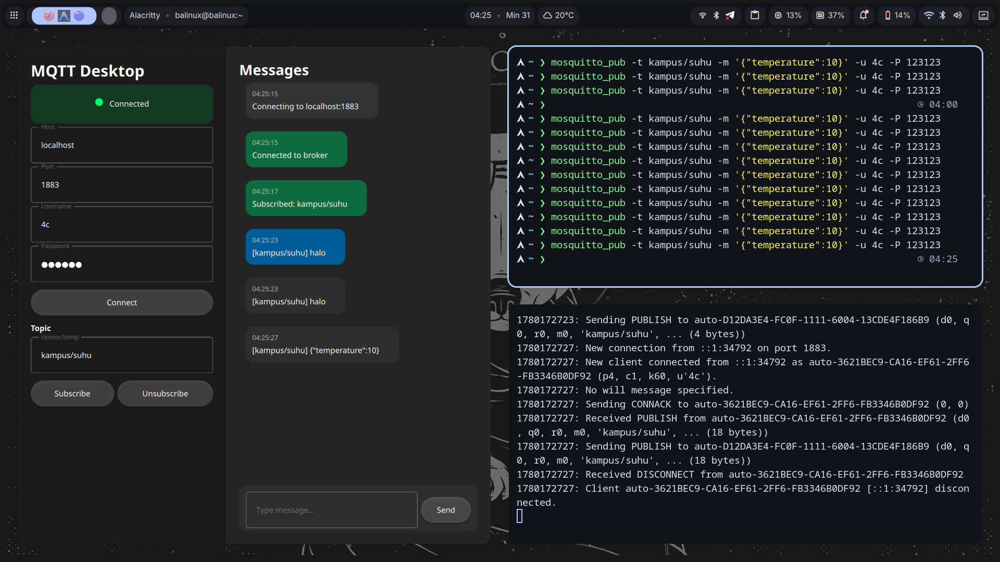

# Python MQTT Client

Aplikasi MQTT Client sederhana namun fungsional yang dibangun dengan Python. Proyek ini menyediakan dua antarmuka: GUI modern menggunakan **PySide6 (Qt for Python) + QML** dan skrip konsol sederhana.

## 📸 Preview


## 📂 Struktur Proyek

- `main.py`: Entry point utama untuk aplikasi GUI.
- `mqtt_manager.py`: Logika inti MQTT dan model data untuk UI. Menggunakan `paho-mqtt` v2.
- `qml/Main.qml`: Definisi antarmuka pengguna menggunakan QML dengan tema Material Dark.
- `simple.py`: Skrip konsol dasar untuk pengujian koneksi cepat.
- `requirements.txt`: Daftar dependensi Python yang diperlukan.
- `.gitignore`: Mengabaikan file yang tidak diperlukan (pycache, .venv, dll).

## ✨ Fitur

### GUI Client (`main.py`)
- **Antarmuka Modern**: Menggunakan Material Design (Dark Theme) yang responsif.
- **Manajemen Koneksi**: Mendukung Host, Port, serta autentikasi Username dan Password.
- **Log Real-time**:
  - Auto-scroll ke pesan terbaru.
  - Indikator warna berdasarkan tipe aktivitas:
    - 🔵 Biru: Pesan Terkirim (`send`)
    - ⚪ Abu-abu: Pesan Diterima (`receive`)
    - 🟢 Hijau: Status Berhasil (`success`)
    - 🔴 Merah: Status Error/Terputus (`error`)
- **Interaksi Topic**:
  - Subscribe dan Unsubscribe topic secara dinamis.
  - Publish pesan ke topic yang sedang aktif.

### Simple Client (`simple.py`)
- Koneksi otomatis ke broker lokal.
- Contoh dasar penggunaan callback `on_connect` dan `on_message`.

## 🛡️ Catatan Keamanan

> [!WARNING]
> Proyek ini memiliki kredensial hardcoded di dalam `simple.py` untuk tujuan demonstrasi. Untuk penggunaan produksi, disarankan menggunakan variabel lingkungan (`.env`) atau input user yang aman. Jangan membagikan file yang berisi password asli ke publik.

## 🚀 Instalasi

1. **Clone Repositori**:
   ```bash
   git clone <repository-url>
   cd python-mqtt
   ```

2. **Persiapkan Virtual Environment**:
   ```bash
   python -m venv .venv
   source .venv/bin/activate  # Linux/macOS
   # atau
   .venv\Scripts\activate     # Windows
   ```

3. **Instal Dependensi**:
   ```bash
   pip install -r requirements.txt
   ```

## 📖 Cara Penggunaan

### Aplikasi GUI
```bash
python main.py
```

### Skrip Konsol
```bash
python simple.py
```

## 🛠️ Dependensi Utama
- [paho-mqtt](https://pypi.org/project/paho-mqtt/) (v2.x)
- [PySide6](https://pypi.org/project/PySide6/) (Qt for Python)

## 📝 Lisensi
Proyek ini bersifat open-source. Silakan gunakan dan modifikasi sesuai kebutuhan.
