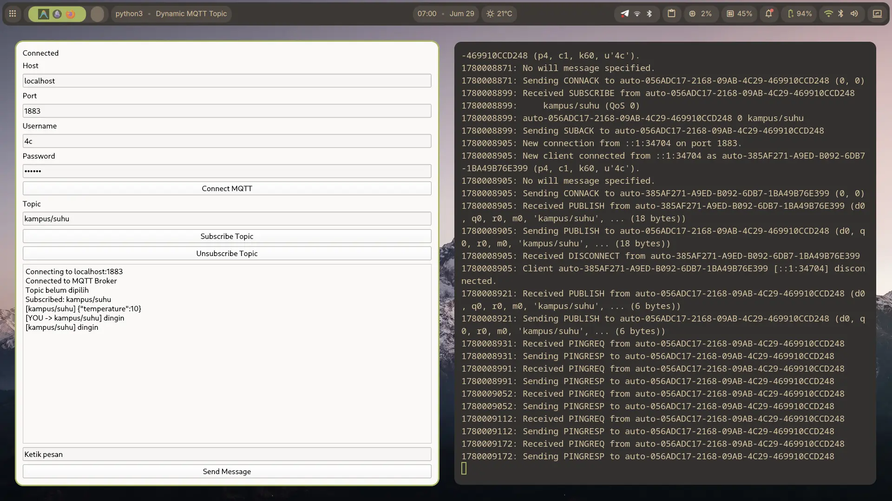

# Python MQTT Client

Sebuah aplikasi MQTT Client sederhana yang dibuat menggunakan Python. Proyek ini mencakup antarmuka grafis (GUI) menggunakan PySide6 dan skrip sederhana berbasis console.

## Fitur

- **GUI Client (`main.py`):**
  - Koneksi ke MQTT Broker dengan Host, Port, Username, dan Password.
  - Subscribe ke banyak topic secara dinamis.
  - Unsubscribe dari topic.
  - Mengirim pesan ke topic yang dipilih.
  - Log aktivitas dan pesan masuk secara real-time.
- **Simple Client (`simple.py`):**
  - Skrip dasar untuk koneksi dan subscribe ke topic tertentu secara otomatis.

## Prasyarat

Sebelum menjalankan proyek ini, pastikan Anda memiliki Python terinstal di sistem Anda.

## Instalasi

1. Clone repositori ini atau download source code-nya.
2. Buat dan aktifkan virtual environment (opsional tapi disarankan):
   ```bash
   python -m venv .venv
   source .venv/bin/activate  # Untuk Linux/macOS
   # atau
   .venv\Scripts\activate     # Untuk Windows
   ```
3. Instal dependensi yang diperlukan:
   ```bash
   pip install -r requirements.txt
   ```

## Cara Penggunaan

### Menjalankan GUI Client
Jalankan perintah berikut untuk membuka aplikasi antarmuka grafis:
```bash
python main.py
```

### Menjalankan Simple Client
Jalankan perintah berikut untuk menjalankan skrip console sederhana:
```bash
python simple.py
```

## Preview GUI


## Dependensi Utama
- [paho-mqtt](https://pypi.org/project/paho-mqtt/) - Client library untuk protokol MQTT.
- [PySide6](https://pypi.org/project/PySide6/) - Library GUI Qt untuk Python.

## Lisensi
Proyek ini bersifat open-source. Silakan gunakan dan modifikasi sesuai kebutuhan.
